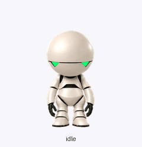

# Marvin

A softly rendered 3D companion inspired by the newer movie adaptation of Marvin the Paranoid Android from *The Hitchhiker’s Guide to the Galaxy*. Huge pearl-white head, green triangular lenses, heavy feet, and very little enthusiasm.

[Open the live preview](https://mhedhli-coreweave.github.io/marvin-h2g2-pet/) to try both animation sets and download either sprite sheet.



## Personality and motion

| State | Motion |
| --- | --- |
| Idle | Heavy sigh, shoulders sag, eye lights go out and reluctantly return |
| Moving right / left | Heel-first trudge with dragging arms and a dark-eye beat |
| Greeting | Dismissive half-wave, limp wrist, eyes off |
| Jump | Deep crouch, reluctant hop, heavy landing |
| Failed | Sustained double facepalm with a deep head and knee collapse |
| Waiting | Broad palms-up shrug, two head tilts, then the arms give up |
| Working | Head leans into one hand while the other taps impatiently |
| Review | Slow accusing point, narrowed eye lights, right-left-right “no” head turn, then lights off |
| Looking around | Sixteen head directions with the body anchored |

Open the local preview to try each state, step through frames, and move the pointer around Marvin. Preview timing is stored in `pet.json`; the Pets host controls its own playback timing.

The **Animation set** selector offers **More angst** (default) and **Original**. The original sheet, frames, previews, sources, prompts, and QA reports are preserved in [`variants/original/`](variants/original/). All sixteen look directions are pixel-identical between the two sets. The new action frames contain held poses and actual dark lenses; they do not rely solely on slower preview timing.


## Preview locally

```sh
python3 -m http.server 8080
```

Open <http://localhost:8080>. The preview has no external dependencies or analytics.

The public preview is served by GitHub Pages from the root of `main`. The `.nojekyll` file keeps the HTML, JSON, and animation assets unchanged. Pushing to `main` updates the preview automatically; changing the active ChatGPT Pet still requires a separate Pets update.

## Rebuild and check

Requires Python 3.10+.

```sh
python3 -m venv .venv
source .venv/bin/activate
pip install -r requirements.txt
python scripts/build.py --check
python scripts/build.py --variant original --check
python scripts/validate.py
python scripts/validate.py variants/original/spritesheet.png
python -m unittest discover -s tests -v
python scripts/render_previews.py --mp4
```

`build.py` assembles the approved frame PNGs without resizing, filtering, or changing pixels. Use `--output build/spritesheet.png` to write a new copy. Both build and preview commands accept `--variant angst` or `--variant original`. GIF and MP4 previews go to `build/previews/<variant>` by default.

## Use as a ChatGPT Pet

The ready-to-use sheet is [`assets/spritesheet.png`](assets/spritesheet.png); the earlier version is [`variants/original/spritesheet.png`](variants/original/spritesheet.png). Ask the Pets plugin to use the desired sheet, updating your existing Marvin if you already have one. It must validate the exact file before upload. This repository does not store account identifiers, upload sessions, or credentials.

The local validator checks grid integrity, transparency, and bounds. The creation workflow also used the Pets bundled visual-quality pipeline and service preflight. See [validation](docs/validation.md), [format](docs/animation-format.md), and [attribution](ATTRIBUTION.md).
